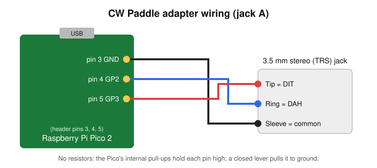
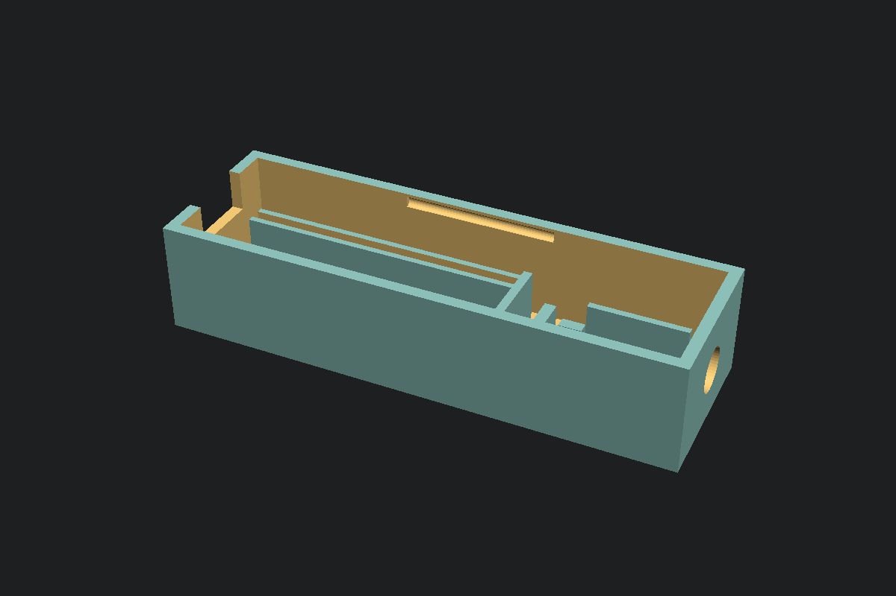
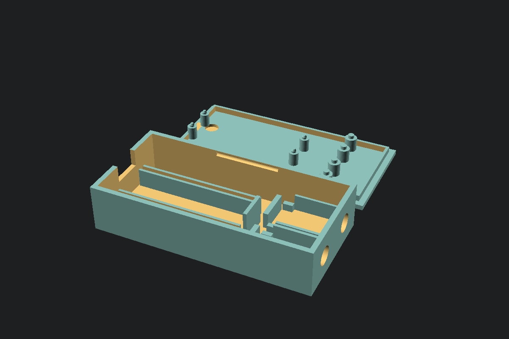
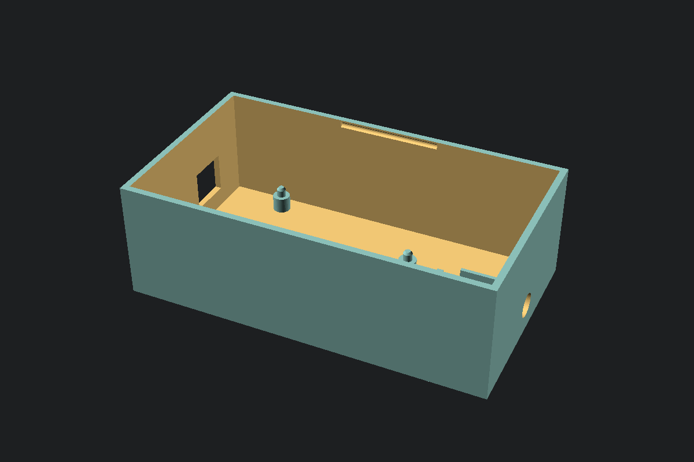

# WY6Y CW Paddle adapter (Pico 2 USB MIDI)

Turns any iambic Morse paddle with a 3.5 mm stereo plug into a USB MIDI
device. No drivers on Windows, macOS or Linux. It was built for two programs:

- **[Night Copy](https://github.com/WY6Y/night-copy)**, a CW trainer game:
  send on a real paddle instead of the keyboard.
- **AetherSDR**, whose host-side keyer sends remote CW on a Hermes Lite 2.

The adapter only reports which lever is closed. The program on the computer
times the dits and dahs and makes the sidetone.

| Paddle | MIDI (channel 1) |
|---|---|
| Dit | Note 20 On/Off |
| Dah | Note 21 On/Off |

USB device name "WY6Y CW Paddle". Night Copy looks for any MIDI input whose
name contains "CW Paddle".

## Parts

| Part | Notes |
|---|---|
| Raspberry Pi Pico 2 or Pico 2 W (RP2350) | Pico 2 **H** (headers already soldered) if you use the printed case |
| 3.5 mm stereo (TRS) jack breakout board | the common 5-pin kind; one or two of them |
| Hookup wire, solder | rosin-core solder only (see Soldering) |
| Micro-USB data cable | some cables are charge-only and won't work |
| Your paddle | 3.5 mm stereo plug, or a 1/4" plug with an adapter |
| Optional | the 3D-printed case in `case/` |

## Wiring

Contacts close to ground through the Pico's internal pull-ups: no resistors.
Two jacks can be wired in parallel so either paddle works.

| Jack | Tip (dit) | Ring (dah) | Sleeve |
|---|---|---|---|
| A | GP3 (pin 5) | GP2 (pin 4) | GND (pin 3) |
| B | GP5 (pin 7) | GP4 (pin 6) | GND (pin 8) |

The breakout boards' 5 pins are usually unlabeled: put a plug in and find
tip, ring and sleeve with a continuity meter. The 2 extra pins are switch
contacts; leave them unconnected. If dit and dah come out backwards, swap the
tip and ring wires or use your program's paddle-swap setting (Night Copy:
SETUP > SWAP PADDLES).

As built by WY6Y (left-handed, Putikeeg mini paddle, Pico 2 W): jack board pin
1 (common) to GND, the two lever pins (2 and 5) to GP2 and GP3; pins 3 and 4
are switch contacts.

## Flash the firmware (any OS)

1. Download a `.uf2` from [Releases](../../releases):
   `cw_paddle-pico2.uf2` for a Pico 2, `cw_paddle-pico2w.uf2` for a Pico 2 W
   (its LED is on the Wi-Fi chip; Wi-Fi is never turned on).
2. Hold the Pico's **BOOTSEL** button while plugging it in. A USB drive named
   **RP2350** appears.
3. Drag the `.uf2` onto it. The Pico reboots as "WY6Y CW Paddle".

LED: slow blink = no computer has picked it up yet; solid = a lever is closed.

## Check it works

- **Windows:** in Night Copy, SETUP > CONNECT PADDLE. The status bar shows
  PADDLE: ONLINE and its DIT/DAH lamps light as you key.
- **Linux:** `./paddle_test.py` prints `DIT DOWN/up`, `DAH DOWN/up` as you key
  (it holds the MIDI port; quit it before starting another program).
  `./paddle_test.py bootsel` reboots the Pico into BOOTSEL for re-flashing.
- **macOS:** it appears in Audio MIDI Setup (Window > Show MIDI Studio).

## Use with Night Copy

- **Windows app:** works directly (SETUP > CONNECT PADDLE).
- **macOS and Linux apps:** their built-in web engine (WebKit) has no Web
  MIDI, so the app can't see the paddle. Workaround: with Night Copy running,
  open `http://127.0.0.1:51600/` in Chrome or Edge and play there. It uses
  the same saved progress. Leave the app's own window on the title screen.

## Use with AetherSDR

Tested with v26.10.8. Settings > MIDI Mapping: port "WY6Y CW Paddle" >
Connect, and tick Auto-connect. Import... `wy6y-cw-paddle.map` only stores it
as a profile: pick `wy6y-cw-paddle` in the Profile box and press **Load**, or
nothing is bound (or Learn `cwdit`/`cwdah` and press each paddle). Put a slice
in CW mode; with Break-in off in the CW panel you get sidetone only, no RF.
After the Pico re-enumerates (replug, reflash) AetherSDR doesn't re-attach:
press Connect again (on Linux, `aconnect 'WY6Y CW Paddle' 'RtMidi Input Client'`).

## Key-down safety

A stuck key on a transmitter is a real problem, so the firmware guards against it:

- A lever closed over 5 s is a fault: the computer gets Note Off and the lever
  is ignored until it opens.
- Both levers' state is re-sent every second, released included, so a lost
  Note Off can't leave the keyer down.
- If notes stop reaching the computer for 1.5 s, the Pico detaches and
  re-attaches USB.
- A 1 s hardware watchdog reboots it if its main loop stops.
- 12 ms debounce (the mini paddle's contacts bounce 4-8 ms).

## Build the firmware yourself

Needs the [Pico SDK](https://github.com/raspberrypi/pico-sdk) 2.x and an Arm
GCC toolchain. On Linux or macOS:

    cmake -B build -DPICO_SDK_PATH=$HOME/pico-sdk && make -C build -j4      # Pico 2
    cmake -B build-w -DPICO_SDK_PATH=$HOME/pico-sdk -DPICO_BOARD=pico2_w \
        && make -C build-w -j4                                               # Pico 2 W

The output is `build/cw_paddle.uf2` (or `build-w/`). The W build needs
`git -C ~/pico-sdk submodule update --init lib/cyw43-driver`. On Windows, the
official Raspberry Pi Pico extension for VS Code installs the SDK and
toolchain and can import this folder as a project. WY6Y builds on a
Raspberry Pi 5 with pico-sdk 2.2.0 and Debian `gcc-arm-none-eabi`.

## Case

`case/case.scad` (OpenSCAD, parametric) with ready STLs for 1 or 2 jacks:
about 87 x 28 x 21 mm (1 jack) or 87 x 43 mm (2 jacks), press-fit lid. USB
out one end, jacks out the other. Print both parts flat, no supports, PETG or PLA.

| 1-jack base | 2-jack base and lid |
|---|---|
|  |  |

- Made for a Pico 2 H (factory headers, pins down): the header plastic rests
  on two rails, the pin tips drop into slots, an end stop takes the USB push,
  and four lid pegs go into the mounting holes. No screws.
- Each jack board sits on ledges against the jack wall, with a stop behind it;
  lid ribs hold it down. A thin window in the lid shows the LED.
- The lid snaps on (a ridge on each side clicks into a groove). Pry at the USB
  end to open.
- Solder the wires to the header pin stubs on the Pico's top side (GP2-GP5,
  GND); jumpers on the pins underneath won't fit in the rails.

Check the values marked MEASURE in `case.scad` (header plastic, pin length,
jack position) against your parts, then re-export:
`openscad -D 'part="base"' -D n_jacks=1 -o base.stl case/case.scad`.

## Arduino Uno R3 stand-in (Linux only)

A temporary paddle if you have an Uno and no Pico. The R3's USB chip is a
serial bridge, not a MIDI device, so `uno/uno_paddle/uno_paddle.ino` sends the
lever state over serial and `uno/uno_bridge.py` on the computer opens the same
"WY6Y CW Paddle" MIDI port. The bridge uses an ALSA virtual port, so it runs on
Linux only; on Windows or macOS, use a Pico.

- Wiring with dupont jumpers: jack common to GND, dit to D3, dah to D2.
  The Uno's L LED lights while a lever is held.
- Same safety as the Pico: 12 ms debounce, 5 s stuck-lever cutoff, state
  re-sent every second; the bridge releases both notes if the Uno goes quiet
  for 2.5 s or is unplugged.
- Flash: `arduino-cli compile --fqbn arduino:avr:uno uno/uno_paddle`, then
  `arduino-cli upload -p /dev/ttyACM0 --fqbn arduino:avr:uno uno/uno_paddle`.
- Bridge: `python3 uno/uno_bridge.py` (needs `python-rtmidi` and `pyserial`).

Case: `case/uno_case.scad`, STLs `case/uno-base.stl` and `case/uno-lid.stl`,
about 112 x 63 x 37 mm plus a 2 mm lid. The Uno sits on four standoffs with
pegs in its mounting holes, with room for duponts standing in the headers.
Check the MEASURE values (USB-B and DC jack positions) against your board.

## Soldering

Use rosin-core solder or an electronics flux only. Plumbing flux (Nokorode,
Oatey No. 95) left a conductive film on WY6Y's first board that held GP2 low
(a stuck dit a continuity beeper couldn't find) and broke USB enumeration until
the boards were washed in soapy water, rinsed with distilled water, and dried.

## USB ID

The firmware uses Raspberry Pi's vendor ID `2e8a` with product ID `10ca`,
which is not registered (fine for personal use). If you make these for other
people, request your own product ID from Raspberry Pi and change `USB_PID` in
`src/usb_descriptors.c`.

Copyright WY6Y, all rights reserved.
